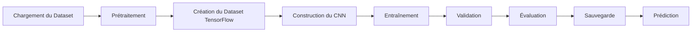
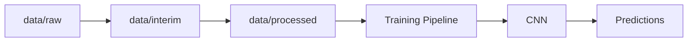

ARCHITECTURE.md
# ARCHITECTURE.md

> **Projet :** FarmerLedger Digitizer
>
> **Parcours :** Machine Learning Builder Track
>
> **Mission :** Projet 01 / 25
>
> **Version :** 1.0
>
> **Statut :** Architecture validée

---

# 1. Objectif du document

Ce document décrit l'architecture technique complète du projet **FarmerLedger Digitizer**.

Il constitue le plan de construction du projet et sert de référence pendant tout le développement.

Il présente notamment :

- l'architecture générale du système ;
- les différents composants ;
- leurs responsabilités ;
- le pipeline Machine Learning ;
- le flux des données ;
- l'organisation du code ;
- les décisions d'architecture retenues.

L'objectif est de garantir une architecture claire, modulaire, évolutive et facilement maintenable.

---

# 2. Vision d'ensemble

FarmerLedger Digitizer est un projet de **Computer Vision** basé sur un pipeline de Machine Learning supervisé.

Son objectif est d'entraîner un modèle capable de reconnaître des caractères manuscrits afin de constituer la première brique d'un futur système de numérisation documentaire.

Le projet est volontairement limité à la reconnaissance de caractères isolés.

Les fonctionnalités plus avancées (OCR complet, segmentation de documents, extraction automatique de tableaux, etc.) seront développées dans des projets ultérieurs du parcours.

---

# 3. Architecture globale

Le projet suit une architecture modulaire.

```text
                        Dataset EMNIST

                              │
                              ▼

                     Prétraitement des données

                              │
                              ▼

                    Construction du Dataset ML

                              │
                              ▼

                      Entraînement du CNN

                              │
                              ▼

                     Évaluation des performances

                              │
                              ▼

                        Modèle sauvegardé

                              │
                              ▼

                        Prédictions finales
```

Cette architecture respecte le cycle de vie classique d'un projet Machine Learning.

---

# 4. Architecture logicielle

Le projet est organisé autour de plusieurs modules indépendants.

```text
                   +-----------------------+
                   |        DATASET        |
                   +-----------+-----------+
                               |
                               ▼
                   +-----------------------+
                   |    PREPROCESSING      |
                   +-----------+-----------+
                               |
                               ▼
                   +-----------------------+
                   |       TRAINING        |
                   +-----------+-----------+
                               |
                               ▼
                   +-----------------------+
                   |      EVALUATION       |
                   +-----------+-----------+
                               |
                               ▼
                   +-----------------------+
                   |      INFERENCE        |
                   +-----------+-----------+
                               |
                               ▼
                   +-----------------------+
                   |       OUTPUTS         |
                   +-----------------------+
```

Chaque module possède une responsabilité unique.

---

# 5. Architecture des dossiers

Le projet respecte le standard défini pour l'ensemble du Machine Learning Builder Track.

```text
FarmerLedgerDigitizer/

│
├── configs/
│
├── data/
│   ├── raw/
│   ├── interim/
│   ├── processed/
│   └── external/
│
├── docs/
│
├── experiments/
│
├── models/
│
├── notebooks/
│
├── outputs/
│
├── scripts/
│
├── src/
│   ├── data/
│   ├── features/
│   ├── models/
│   ├── training/
│   ├── evaluation/
│   ├── inference/
│   ├── utils/
│   └── main.py
│
├── tests/
│
├── README.md
│
└── requirements.txt
```

---

# 6. Responsabilités des dossiers

## configs/

Contient toute la configuration du projet.

Exemples :

- chemins
- hyperparamètres
- configuration du logging

---

## data/

Contient toutes les données.

Le dossier est divisé en plusieurs niveaux afin de préserver les données originales.

---

## docs/

Documentation complète du projet.

---

## experiments/

Historique des différentes expérimentations réalisées.

---

## models/

Contient les modèles entraînés.

Exemples :

- checkpoints
- modèles finaux
- modèles exportés

---

## notebooks/

Exploration des données.

Les notebooks ne contiennent jamais la logique métier.

---

## outputs/

Résultats générés.

Par exemple :

- figures
- métriques
- prédictions

---

## scripts/

Scripts utilitaires.

---

## src/

Contient l'ensemble du code source.

Il s'agit du cœur du projet.

---

## tests/

Tests unitaires et tests fonctionnels.

---

# 7. Architecture du pipeline Machine Learning

Le pipeline suit les étapes suivantes.



---

# 8. Flux des données

Les données circulent toujours dans le même sens.



Les données originales ne sont jamais modifiées.

---

# 9. Architecture des modules

## Module Dataset

Responsabilités :

- chargement
- vérification
- séparation train/test
- création des DataLoaders

---

## Module Preprocessing

Responsabilités :

- normalisation

- redimensionnement

- nettoyage

- préparation des images

---

## Module Model

Responsabilités :

- définition du CNN

- compilation

- sauvegarde

- chargement

---

## Module Training

Responsabilités :

- entraînement

- callbacks

- checkpoints

- suivi des métriques

---

## Module Evaluation

Responsabilités :

- accuracy

- loss

- matrice de confusion

- rapport de classification

---

## Module Inference

Responsabilités :

- chargement du modèle

- prédiction

- affichage

---

## Module Utils

Responsabilités :

- fonctions utilitaires

- helpers

- configuration

- logging

---

# 10. Architecture des dépendances

```text
TensorFlow
        │
        ├──── CNN
        │
OpenCV ─┤
        │
NumPy ──┤
        │
pandas ─┤
        │
Matplotlib
        │
scikit-learn
```

Chaque bibliothèque possède un rôle clairement identifié.

---

# 11. Décisions d'architecture (ADR)

## ADR-001

Le projet adopte une architecture modulaire.

**Justification**

Favoriser la maintenabilité.

---

## ADR-002

Les notebooks ne contiennent pas la logique métier.

**Justification**

Permettre la réutilisation du code.

---

## ADR-003

Les données originales restent immuables.

**Justification**

Garantir la reproductibilité.

---

## ADR-004

Toute la logique métier est centralisée dans le dossier `src/`.

**Justification**

Respect des bonnes pratiques professionnelles.

---

## ADR-005

Le modèle est développé avec TensorFlow/Keras.

**Justification**

Compatible avec les objectifs pédagogiques du projet et adapté à un premier CNN.

---

## ADR-006

Le projet est conçu pour évoluer.

**Justification**

Cette architecture pourra accueillir ultérieurement :

- OCR complet
- segmentation documentaire
- modèles Transformer
- API REST
- déploiement cloud
- pipeline MLOps

sans remise en cause de sa structure.

---

# 12. Principes d'architecture

Le projet respecte les principes suivants :

- modularité ;
- séparation des responsabilités ;
- reproductibilité ;
- évolutivité ;
- lisibilité ;
- simplicité ;
- maintenabilité ;
- documentation systématique.

---

# 13. Architecture cible à long terme

Le projet actuel constitue uniquement la première couche d'une architecture documentaire beaucoup plus ambitieuse.

À terme, cette architecture pourra évoluer vers :

```text
Document

        │

Prétraitement

        │

Détection des lignes

        │

Segmentation

        │

Reconnaissance

        │

Correction

        │

Extraction des champs

        │

Base de données

        │

Recherche intelligente

        │

Assistant IA
```

Le présent projet implémente uniquement la partie :

```text
Reconnaissance
```

Toutes les autres briques seront développées progressivement dans les projets suivants.

---

# 14. Conclusion

L'architecture retenue privilégie la simplicité sans sacrifier la qualité.

Elle est suffisamment légère pour un premier projet du parcours, tout en étant suffisamment professionnelle pour servir de fondation aux missions futures.

Cette approche garantit :

- une progression pédagogique cohérente ;
- un code maintenable ;
- une documentation claire ;
- une excellente réutilisabilité des composants ;
- une évolution naturelle vers des systèmes d'IA documentaires de niveau production.