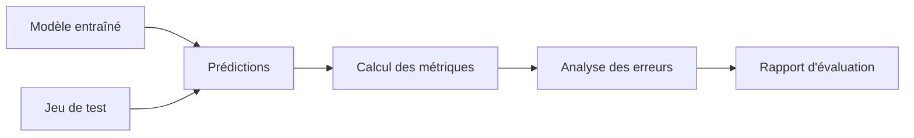

# EVALUATION.md

> **Projet :** FarmerLedger Digitizer
>
> **Parcours :** Machine Learning Builder Track
>
> **Mission :** Projet 01 / 25
>
> **Version :** 1.0
>
> **Statut :** Stratégie d'évaluation validée

---

# 1. Objectif du document

Ce document décrit la stratégie officielle d'évaluation du modèle de reconnaissance de caractères manuscrits développé dans le cadre du projet **FarmerLedger Digitizer**.

L'évaluation constitue une étape essentielle du cycle de vie d'un modèle de Machine Learning. Elle permet de mesurer objectivement les performances du modèle, d'identifier ses points forts, de détecter ses limites et de guider les améliorations futures.

Ce document définit :

- les objectifs de l'évaluation ;
- les jeux de données utilisés ;
- les métriques retenues ;
- les protocoles d'évaluation ;
- les analyses à produire ;
- les critères de validation ;
- les limites des résultats obtenus.

---

# 2. Objectifs de l'évaluation

L'évaluation poursuit plusieurs objectifs.

## Objectif principal

Déterminer si le modèle est capable de reconnaître correctement des caractères manuscrits qu'il n'a jamais vus auparavant.

## Objectifs secondaires

L'évaluation doit également permettre de :

- mesurer la capacité de généralisation ;
- détecter les classes difficiles à reconnaître ;
- identifier les erreurs récurrentes ;
- comparer plusieurs versions du modèle ;
- orienter les améliorations futures.

---

# 3. Jeux de données utilisés

L'évaluation repose sur trois ensembles de données.

| Jeu | Utilisation |
|------|-------------|
| Training | Apprentissage |
| Validation | Ajustement du modèle |
| Test | Évaluation finale |

Le jeu **Test** reste totalement indépendant du processus d'entraînement.

Il ne doit jamais être utilisé pour ajuster les paramètres du modèle.

---

# 4. Pipeline d'évaluation



---

# 5. Métriques retenues

L'évaluation repose sur plusieurs métriques complémentaires.

Aucune métrique ne doit être interprétée isolément.

---

## 5.1 Accuracy

### Définition

L'Accuracy représente la proportion de prédictions correctes.

### Formule

```
Accuracy =
Nombre de prédictions correctes
--------------------------------
Nombre total de prédictions
```

### Utilité

Elle fournit une vision globale des performances.

### Limite

Elle ne permet pas d'identifier les classes problématiques.

---

## 5.2 Loss

La Loss mesure l'erreur du modèle pendant l'apprentissage.

Deux courbes seront suivies :

- Training Loss
- Validation Loss

Ces courbes permettront de détecter :

- le surapprentissage ;
- le sous-apprentissage ;
- les problèmes de convergence.

---

## 5.3 Precision

La précision mesure la proportion de prédictions positives réellement correctes.

Elle est particulièrement utile lorsque certaines classes sont souvent confondues.

---

## 5.4 Recall

Le rappel mesure la capacité du modèle à retrouver correctement les véritables exemples d'une classe.

---

## 5.5 F1-Score

Le F1-Score combine :

- Precision
- Recall

Il constitue une mesure équilibrée des performances.

---

# 6. Matrice de confusion

La matrice de confusion est un outil essentiel pour comprendre le comportement du modèle.

Elle permet notamment :

- d'identifier les classes les plus souvent confondues ;
- de visualiser les erreurs ;
- d'orienter les améliorations.

Exemple simplifié :

```text
             Prédiction

           A   B   C

Réel A    98   2   0

Réel B     3  95   2

Réel C     1   4  95
```

---

# 7. Rapport de classification

Le projet générera automatiquement un rapport comprenant :

- Precision ;
- Recall ;
- F1-Score ;
- Support.

Ce rapport sera produit à l'aide de **scikit-learn**.

Il permettra d'analyser les performances pour chaque classe individuellement.

---

# 8. Visualisations

L'évaluation produira plusieurs graphiques.

## Courbe Accuracy

Elle montre la progression de la précision pendant l'entraînement.

---

## Courbe Loss

Elle permet de suivre la convergence du modèle.

---

## Matrice de confusion

Visualisation des erreurs de classification.

---

## Exemples de prédictions

Le projet affichera plusieurs exemples de :

- prédictions correctes ;
- erreurs de classification.

Cette analyse qualitative complète les métriques quantitatives.

---

# 9. Analyse des erreurs

Toutes les erreurs ne se valent pas.

Une analyse détaillée sera réalisée.

Les erreurs seront classées selon plusieurs catégories :

## Erreurs dues à une écriture ambiguë

Exemple :

- O et 0
- I et l
- S et 5

---

## Erreurs dues à la qualité de l'image

Exemples :

- bruit ;
- faible contraste ;
- caractère incomplet.

---

## Erreurs dues au modèle

Le modèle peut :

- manquer de capacité ;
- ne pas avoir suffisamment appris certaines classes.

---

## Erreurs dues au dataset

Certaines classes sont naturellement plus difficiles.

Le dataset peut également présenter :

- des exemples atypiques ;
- des écritures ambiguës.

---

# 10. Critères de validation

Le modèle sera considéré comme acceptable si les conditions suivantes sont réunies.

## Fonctionnement

- le pipeline est entièrement exécutable ;
- aucune erreur bloquante.

---

## Performances

- convergence correcte ;
- Accuracy satisfaisante ;
- absence de surapprentissage majeur.

---

## Qualité

- métriques calculées correctement ;
- graphiques générés ;
- rapport de classification produit.

---

## Documentation

Toutes les métriques devront être enregistrées dans le dossier :

```text
outputs/
```

---

# 11. Comparaison des modèles

Si plusieurs modèles sont entraînés, ils devront être comparés.

Les critères de comparaison incluent :

- Accuracy ;
- Loss ;
- temps d'entraînement ;
- taille du modèle ;
- vitesse d'inférence.

Toutes les comparaisons devront être documentées.

---

# 12. Interprétation des résultats

Les résultats ne devront jamais être analysés uniquement à partir d'un chiffre.

Chaque expérience devra répondre aux questions suivantes :

- Le modèle généralise-t-il correctement ?
- Les performances sont-elles stables ?
- Certaines classes sont-elles plus difficiles ?
- Le modèle est-il surentraîné ?
- Les résultats sont-ils cohérents avec les objectifs du projet ?

Cette analyse qualitative est indispensable.

---

# 13. Limites de l'évaluation

L'évaluation réalisée dans ce projet présente plusieurs limites.

Le dataset ne contient pas :

- des pages complètes ;
- des tableaux manuscrits ;
- des registres historiques ;
- des documents complexes.

Les résultats obtenus ne doivent donc pas être interprétés comme ceux d'un système OCR complet.

Ils évaluent uniquement la capacité du modèle à reconnaître des caractères isolés.

---

# 14. Perspectives

Les projets suivants permettront d'enrichir la stratégie d'évaluation.

Par exemple :

- Cross Validation ;
- ROC Curve ;
- AUC ;
- Calibration des probabilités ;
- Robustesse au bruit ;
- Tests sur des données réelles ;
- Explainable AI (Grad-CAM, SHAP, LIME) ;
- Évaluation de modèles Transformer.

Ces méthodes seront introduites progressivement au fil du parcours.

---

# 15. Décisions d'architecture

## ADR-012

L'évaluation repose sur plusieurs métriques complémentaires.

**Justification**

Aucune métrique unique ne permet d'évaluer correctement un modèle de classification.

---

## ADR-013

Le jeu de test reste totalement indépendant.

**Justification**

Garantir une évaluation honnête de la capacité de généralisation.

---

## ADR-014

Toutes les visualisations sont générées automatiquement.

**Justification**

Faciliter l'analyse des performances et la reproductibilité.

---

## ADR-015

Les erreurs sont analysées qualitativement.

**Justification**

Comprendre les limites du modèle est aussi important que mesurer ses performances.

---

# 16. Résumé

L'évaluation constitue la dernière étape scientifique du pipeline Machine Learning.

Elle ne se limite pas à mesurer une **Accuracy**, mais vise à comprendre le comportement du modèle, à identifier ses forces, à mettre en évidence ses faiblesses et à préparer les améliorations futures.

Cette approche garantit une évaluation rigoureuse, reproductible et conforme aux bonnes pratiques professionnelles du Machine Learning.