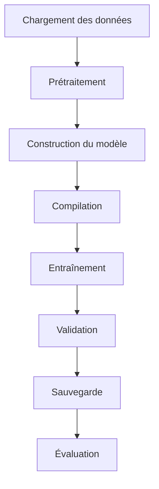

# TRAINING.md

> **Projet :** FarmerLedger Digitizer
>
> **Parcours :** Machine Learning Builder Track
>
> **Mission :** Projet 01 / 25
>
> **Version :** 1.0
>
> **Statut :** Stratégie d'entraînement validée

---

# 1. Objectif du document

Ce document décrit la stratégie d'entraînement du modèle de Deep Learning utilisé dans le projet **FarmerLedger Digitizer**.

Il constitue le guide officiel permettant de reproduire l'entraînement du modèle dans des conditions identiques.

Il décrit :

- la préparation des données ;
- la configuration de l'environnement ;
- les hyperparamètres ;
- le pipeline d'entraînement ;
- les callbacks ;
- la sauvegarde des modèles ;
- la reproductibilité des expériences ;
- l'organisation des expérimentations.

L'objectif est de garantir un entraînement reproductible, documenté et conforme aux bonnes pratiques du Machine Learning.

---

# 2. Objectifs de l'entraînement

L'entraînement vise à construire un modèle capable de reconnaître correctement les caractères manuscrits du dataset EMNIST Balanced.

Plus précisément, il doit permettre :

- d'apprendre les caractéristiques des caractères manuscrits ;
- de généraliser sur des données non vues ;
- de produire un modèle réutilisable pour les étapes d'inférence ;
- d'obtenir des performances suffisamment élevées tout en limitant le surapprentissage.

---

# 3. Prérequis

Avant de lancer l'entraînement, les conditions suivantes doivent être satisfaites.

## Environnement Python

L'environnement virtuel doit être correctement configuré.

Les principales bibliothèques nécessaires sont :

- TensorFlow / Keras
- TensorFlow Datasets
- OpenCV
- NumPy
- pandas
- Matplotlib
- scikit-learn

---

## Dataset

Le dataset EMNIST Balanced doit :

- être téléchargé ;
- être accessible ;
- être vérifié ;
- être correctement structuré dans le dossier `data/`.

---

## Configuration

Tous les paramètres d'entraînement doivent être centralisés dans les fichiers du dossier :

```text
configs/
```

Aucun hyperparamètre ne doit être codé directement dans le code source.

---

# 4. Préparation des données

Avant l'entraînement, les données suivent plusieurs étapes.


---

# 5. Prétraitements

Les traitements suivants seront appliqués.

## Vérification des données

Chaque image devra :

- être lisible ;
- posséder un label valide ;
- avoir les dimensions attendues.

---

## Normalisation

Les pixels seront convertis dans une plage comprise entre :

```text
0 → 1
```

Cette étape améliore la stabilité de l'apprentissage.

---

## Mise en forme

Les images seront converties au format :

```text
28 × 28 × 1
```

afin d'être compatibles avec les couches convolutionnelles.

---

## Préparation des labels

Les labels seront conservés sous forme d'entiers afin d'utiliser la fonction de perte **Sparse Categorical Crossentropy**.

---

# 6. Répartition des données

Le dataset sera divisé en trois ensembles.

| Ensemble | Objectif |
|-----------|----------|
| Training | Apprentissage du modèle |
| Validation | Ajustement des hyperparamètres |
| Test | Évaluation finale |

Le jeu de test ne devra jamais être utilisé pendant l'entraînement.

---

# 7. Configuration des hyperparamètres

Les paramètres initiaux recommandés sont les suivants.

| Paramètre | Valeur |
|-----------|--------|
| Batch Size | 32 |
| Epochs | 20 |
| Learning Rate | 0.001 |
| Optimiseur | Adam |
| Fonction de perte | Sparse Categorical Crossentropy |
| Métrique principale | Accuracy |

Ces paramètres constituent une configuration de référence et pourront évoluer au cours des expérimentations.

---

# 8. Pipeline d'entraînement

Le processus d'entraînement suit les étapes suivantes.



---

# 9. Compilation du modèle

Avant l'entraînement, le modèle sera compilé avec :

- Optimiseur : Adam
- Fonction de perte : Sparse Categorical Crossentropy
- Métrique principale : Accuracy

Cette configuration représente un excellent compromis entre simplicité et performances pour un premier projet.

---

# 10. Callbacks

Afin de rendre l'entraînement plus robuste, plusieurs callbacks seront utilisés.

## Model Checkpoint

Objectif :

Sauvegarder automatiquement le meilleur modèle obtenu.

Critère :

- meilleure performance sur le jeu de validation.

---

## Early Stopping

Objectif :

Arrêter automatiquement l'entraînement si le modèle ne progresse plus.

Avantages :

- réduction du temps d'entraînement ;
- limitation du surapprentissage.

---

## Reduce Learning Rate on Plateau

Objectif :

Réduire automatiquement le taux d'apprentissage lorsque la progression ralentit.

Cette stratégie améliore souvent la convergence.

---

# 11. Sauvegarde des modèles

Les modèles seront enregistrés dans :

```text
models/

├── checkpoints/

├── trained/

└── exported/
```

Les sauvegardes comprennent :

- le meilleur modèle ;
- le modèle final ;
- les poids du réseau si nécessaire.

---

# 12. Suivi de l'entraînement

Pendant chaque entraînement, les informations suivantes seront enregistrées :

- Accuracy d'entraînement ;
- Accuracy de validation ;
- Loss d'entraînement ;
- Loss de validation ;
- durée d'entraînement.

Ces données permettront de comparer les différentes expériences.

---

# 13. Gestion des expérimentations

Toutes les expérimentations seront conservées.

Structure recommandée :

```text
experiments/

├── exp_001/

├── exp_002/

├── exp_003/
```

Chaque expérience devra contenir :

- configuration utilisée ;
- hyperparamètres ;
- métriques obtenues ;
- graphiques ;
- observations ;
- conclusions.

Aucune expérimentation ne devra être supprimée sans justification.

---

# 14. Reproductibilité

Le projet doit permettre à une autre personne d'obtenir des résultats comparables.

Pour cela :

- les dépendances seront figées ;
- les configurations seront versionnées ;
- les scripts d'entraînement seront identiques ;
- les chemins seront centralisés ;
- les expériences seront documentées.

La reproductibilité est une exigence fondamentale du projet.

---

# 15. Gestion des erreurs

Avant chaque entraînement, plusieurs vérifications seront réalisées.

- présence du dataset ;
- cohérence des dimensions ;
- validité des labels ;
- disponibilité du dossier de sauvegarde ;
- espace disque suffisant.

En cas d'erreur, le processus devra produire des messages explicites facilitant le diagnostic.

---

# 16. Critères de validation

Une session d'entraînement est considérée comme valide lorsque :

- le modèle s'entraîne sans erreur ;
- les métriques évoluent de manière cohérente ;
- le meilleur modèle est sauvegardé ;
- les courbes d'apprentissage sont générées ;
- les résultats sont enregistrés dans le dossier `outputs/`.

---

# 17. Évolutions futures

La stratégie d'entraînement pourra être enrichie dans les projets suivants.

Par exemple :

- Data Augmentation ;
- Batch Normalization ;
- Mixed Precision Training ;
- Transfer Learning ;
- Fine-Tuning ;
- Entraînement distribué ;
- MLflow pour le suivi des expériences ;
- Hyperparameter Tuning automatisé (Keras Tuner, Optuna).

Ces améliorations seront introduites progressivement afin de respecter la progression pédagogique du parcours.

---

# 18. Résumé

La stratégie d'entraînement définie dans ce document repose sur quatre principes fondamentaux :

- **Reproductibilité** : chaque expérience doit pouvoir être reproduite.
- **Traçabilité** : chaque décision et chaque résultat doivent être documentés.
- **Modularité** : les composants d'entraînement doivent rester indépendants et réutilisables.
- **Évolutivité** : l'architecture doit pouvoir accueillir des stratégies d'entraînement plus avancées dans les projets futurs.

Cette approche garantit un entraînement professionnel, cohérent avec les objectifs du **Machine Learning Builder Track**, tout en constituant une base solide pour les missions suivantes.